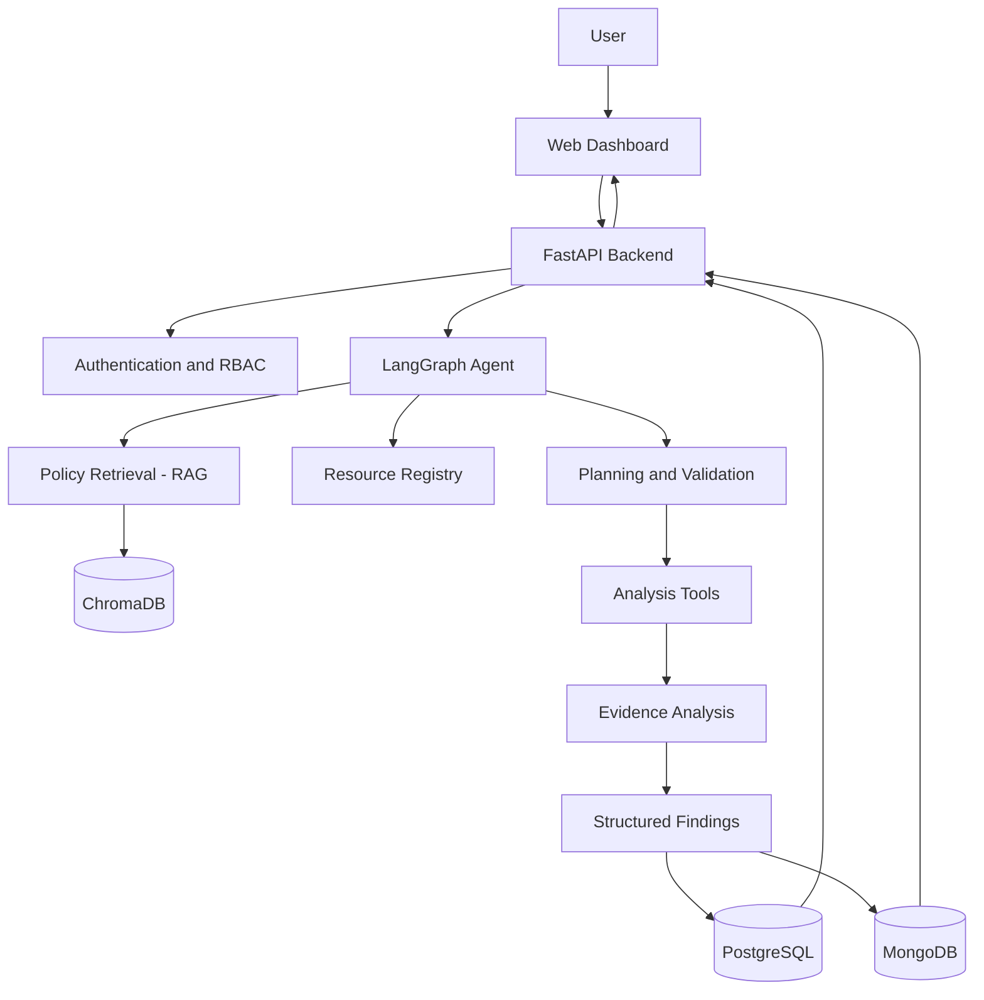

# ChainScope X

**AI Agent Security, Policy Compliance & Evidence Analysis**

ChainScope X is a security analysis platform for examining AI agent behavior. It combines policy-aware retrieval, resource inspection, controlled tool execution, and evidence-based analysis to identify activity that may violate security policies or declared capabilities.

## Key Features

- **LangGraph Agent Workflow** — Coordinates multi-stage security analysis.
- **Policy-Aware RAG** — Uses semantic retrieval to find relevant policy documents.
- **Resource Inspection** — Reviews registered resources and declared capabilities.
- **Planning and Validation** — Prepares and validates analysis operations before execution.
- **Evidence-Based Findings** — Compares observed effects with expected behavior and applicable policies.
- **Analysis Dashboard** — Supports reviewing findings, analysis runs, evidence, and execution timelines.
- **Policy Management** — Supports policy indexing, search, inspection, and deactivation.
- **Application Security** — Includes Google OAuth 2.0, role-based access control, rate limiting, and CSRF protection.

## Analysis Workflow

The LangGraph workflow coordinates the following stages:

1. Validate the analysis request.
2. Retrieve relevant policies using RAG.
3. Inspect registered resources and capabilities.
4. Plan the analysis operations.
5. Validate the proposed plan.
6. Execute the selected analysis tools.
7. Evaluate observed effects against expected behavior and applicable policies.
8. Generate and persist structured findings and evidence references.

## Architecture



## Findings

Each finding can include:

- **Type** — The category of the identified condition.
- **Assessment** — The analysis outcome, such as a confirmed violation, behavioral mismatch, potential risk, or inconclusive result.
- **Severity** — The assessed impact or risk level.
- **Classification** — The sensitivity level of the associated information.
- **Evidence References** — Links to supporting analysis evidence.
- **Analysis Run** — The run associated with the finding.

## Dashboard

The web interface provides views for the system overview, findings, analysis runs, evidence and timelines, new analysis requests, policy documents, and account information.

## Security

- **Google OAuth 2.0** for user authentication.
- **Role-Based Access Control (RBAC)** with Admin, Analyst, and Viewer roles.
- **Rate limiting** for API request protection.
- **CSRF protection** for state-changing operations.

## Technology Stack

| Area | Technology |
|---|---|
| Language | Python |
| Backend | FastAPI |
| Agent orchestration | LangGraph |
| Retrieval | Retrieval-Augmented Generation (RAG) |
| Vector database | ChromaDB |
| Relational database | PostgreSQL |
| NoSQL database | MongoDB |
| Authentication | Google OAuth 2.0 |
| Database migrations | Alembic |
| Interface | Web dashboard |

## Project Structure

```text
ChainScope-X/
├── app/
│   ├── agent/
│   ├── api/
│   ├── security/
│   └── main.py
├── data/
│   └── policies/
├── docs/
├── alembic/
├── tests/
├── requirements.txt
└── .env.example
```

## Vision

ChainScope X aims to make agentic systems more transparent and accountable by connecting policy awareness, resource inspection, controlled execution, and evidence-based security analysis in one platform.