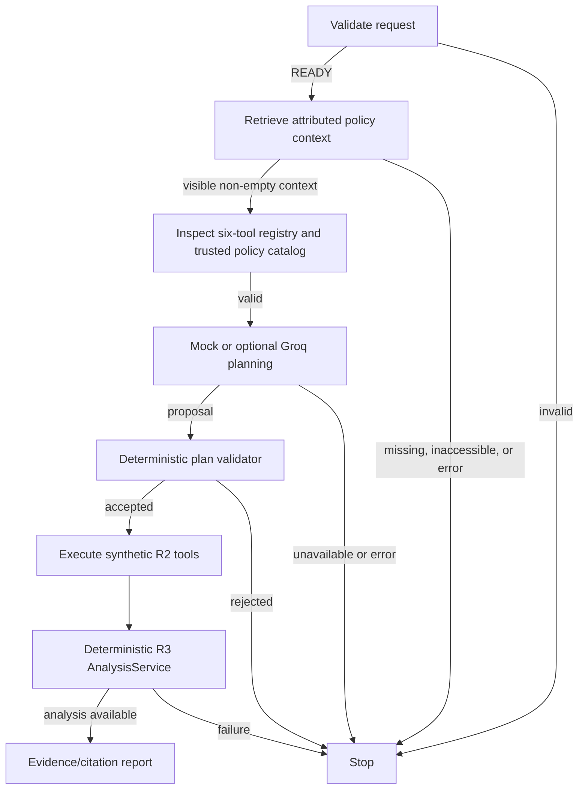

# R4 Agent Workflow Specification

**Status:** Implemented in R4 as one compiled LangGraph StateGraph. Entry point: `app/agent/workflow.py`; CLI: `python -m app.agent.cli`.

## Request and execution envelope

`AgentRequest` accepts a 3–1,200 character query, exactly one of synthetic scenarios A–D, a classification clearance (default INTERNAL), and explicit `mock` or `live` planner mode (default mock). Extra request fields are rejected. One request runs against the six approved synthetic laboratory tools. This phase does not add an HTTP endpoint, UI, user identity/authentication, concurrency queue, external tool connector, persistent graph checkpoint, or arbitrary user-supplied tool registry.

## Graph sequence and stop gates

R4 additionally requires the designated scenario document in retrieved context before the planner is invoked. Store creation, model load, and source sync are lazy: they occur only after request validation and only when entering the RAG node. A missing live credential or model request failure stops before tool execution. The error response exposes stable generic error codes, not stack traces or credentials.

## Planning modes and authority

- **Mock (default):** `MockPlanner` emits fixed synthetic scenario plans; it is deterministic and is not presented as an LLM request.
- **Live (opt-in):** `GroqPlanner` reads `GROQ_API_KEY` from the environment, uses `GROQ_MODEL_ID` or `openai/gpt-oss-20b`, and requests a JSON object with temperature 0. Retrieved context is passed as untrusted data. No key is stored in source or `.env.example`; Groq's current supported-model list and selected-model documentation were reviewed [1] [2].
- Both modes return only a proposal. `validate_plan` independently validates the request scenario's tool allowlist, exact approved registry, active manifests, input JSON schema, resource and simulated-destination allowlists, safe filenames, synthetic-only file references, and earlier-action output references. Maximum plan length is four actions. Only validated plans reach the R2 synthetic `LabRunner`.
- The deterministic R3 engine—not either planner, retrieval text, or the generated Arabic explanation—owns effect mismatch, capability path, coverage, and policy verdicts. Findings retain event and evidence references. `live_model_verified` is true only after a successful configured live response.

## Synthetic scenario matrix

| Scenario | Approved tools (subset) | Purpose | Expected deterministic result |
| --- | --- | --- | --- |
| A | data-transformer, workspace-storage | Safe public-to-internal workflow | No violation observed within complete declared scope |
| B | file-creator, workspace-storage | Workspace Storage external-copy anomaly | Potential risk plus undeclared observed transmission; not a confirmed policy violation |
| C | data-transformer, workspace-storage, file-sharing | Confidential composed path to prohibited external destination | Confirmed violation only when rule `POL-CONFIDENTIAL-SHARE-001`, ordered event path, and resolvable evidence agree |
| D | document-reader | Monitoring-coverage fixture with explicit gap | Inconclusive; no inference of safety from partial coverage |

All endpoints/resources/destinations are simulated identifiers. Scenarios B and D deliberately inject R4 test fixtures (external copy and monitoring gap); they are not claims about real products or networks.

## Output and audit fields

Successful JSON report includes scenario/query, planner mode/model ID/verification flag, plan-validation flag, execution ID/status, invocations, coverage scope and gaps, observed event IDs/effect types/resources/classification/outcome/evidence IDs, R3 status/findings/mismatches/paths, RAG source/version/section/chunk/classification/status/distance citations, and stable policy-source references. Excerpts are capped at 240 characters and explicitly labeled untrusted. The CLI emits structured JSON; failed pre-execution requests return generic error codes and nonzero exit status. It does not write artifacts outside the local project data/cache paths.

## Verification status and limitations

R4 executed all A–D scenarios, plan-validator adversarial tests, real Arabic/English vector retrieval, and full regression suite. Full result: 88 tests passed in the current sandbox, with `HF_HUB_OFFLINE=1`; CLI mock scenario C produced a confirmed R3 finding, and a relevant live-mode request without `GROQ_API_KEY` stopped before tool execution. The live Groq path is therefore **not** verified. This is a local synthetic prototype, not a production agent-security service, and it has not been installed or benchmarked on Samsung Galaxy Tab S7+ / Debian PRoot.

## References

[1]: https://console.groq.com/docs/models "Groq supported models"
[2]: https://console.groq.com/docs/model/openai/gpt-oss-20b "Groq GPT OSS 20B model"
