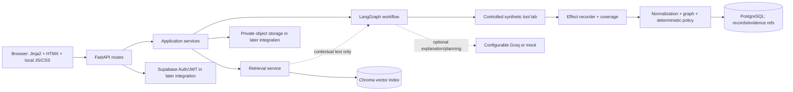
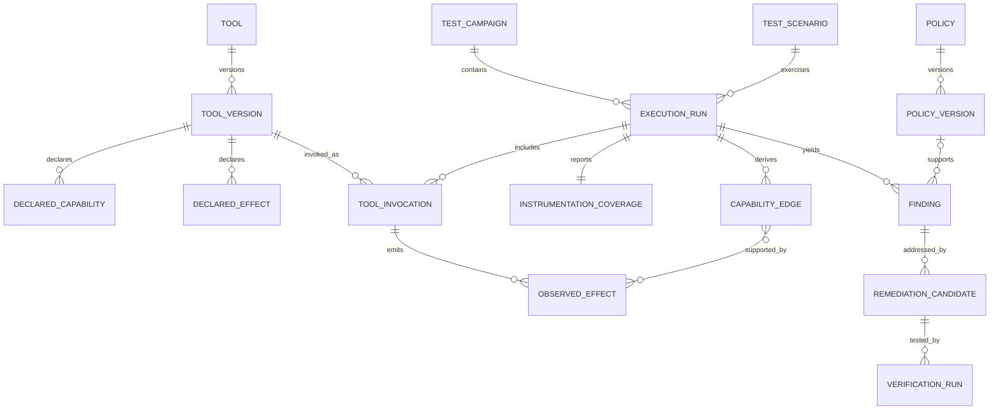
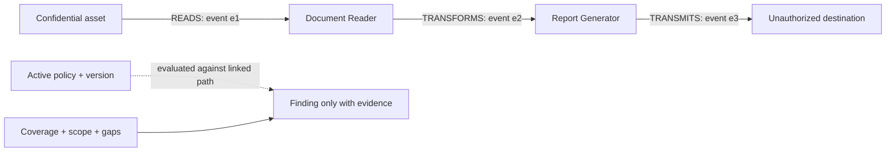
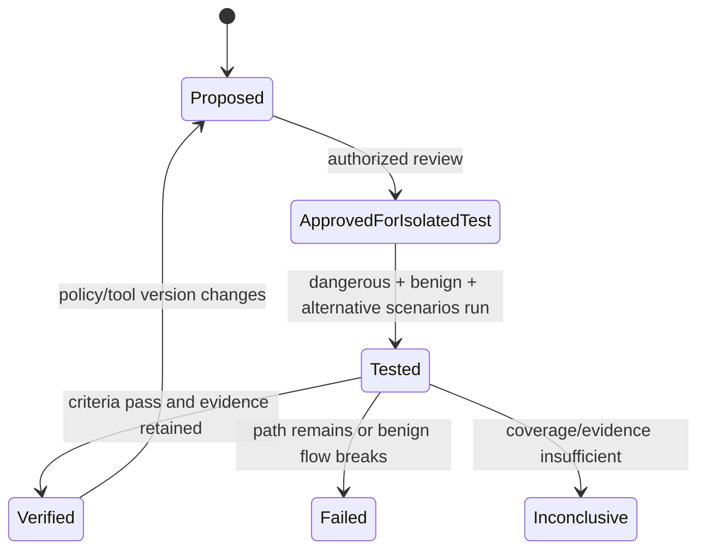

# Architecture (R1 target design)

## Decisions and boundaries
A lightweight server-rendered FastAPI web application remains the approved direction: Jinja2, HTMX and vanilla JS with local assets; no frontend framework change. Application logic is layered (API/templates → services → deterministic domain engines → repositories), with PostgreSQL relational persistence, ChromaDB only for vector retrieval, a controlled synthetic tool lab, and LangGraph as future orchestration. Hosted Groq is optional/configurable; deterministic mock mode remains. R1 implements only domain validation contracts, not these integrated services.

Monitoring claims are limited to events emitted by the tested controlled instrumentation layer. Coverage is explicit per run. There is no claim of OS-wide or complete external side-effect observation. Policy verdicts are deterministic and event-backed; RAG/LLM may retrieve or explain but cannot create evidence or decide authoritative violations.

## System architecture


## Core entity relationships


## Effect capture and analysis flow
```mermaid
sequenceDiagram
  participant O as Orchestrator
  participant T as Registered synthetic tool
  participant I as Instrumentation boundary
  participant C as Coverage record
  participant G as Graph/policy evaluator
  participant P as Persistence
  O->>T: invoke(tool_id, invocation_id, execution_id)
  T->>I: report controlled operation + evidence
  I->>I: validate IDs, sequence, scope, classification
  I->>C: record monitored scope and gaps/status
  I->>G: immutable event references
  G->>G: compare declaration; construct only event-backed edges
  G->>G: evaluate active deterministic rules
  G->>P: findings + evidence links + coverage + uncertainty
```

## Composed path


## Remediation / verification lifecycle


## Data and trust zones
Synthetic test fixtures and local simulated sinks are isolated from real external destinations. The recorder produces structured facts and evidence references; the graph and policy engine operate deterministically. Retrieved documents and LLM output are untrusted context. No secret is placed in browser code. Production identity, database, and object storage integrations are fail-closed and later-phase work.
